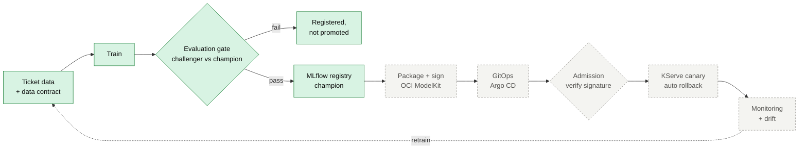

# kubernetes-secure-mlops-pipeline

An MLOps pipeline on Kubernetes where every model that reaches production is **reproducible, evaluated against the
model it replaces, signed, verified at deploy time, rolled out gradually and rolled back automatically**.

**Status: under construction.** Phase 1 works and is tested: data contract, training, the evaluation gate, the
MLflow registry and the Kubeflow pipeline. Packaging, signing and delivery to Kubernetes come next. This README
describes only what works; planned stages are marked as such.

## How it works

Green stages are built and tested; dashed stages are planned. A model reaches the registry's `champion` alias only
if it meets absolute floors (accuracy, macro F1, every team's recall, calibration, latency) **and** does not regress
against the current champion on the same tickets, overall, per team or on any sizeable slice. Every run records the
fingerprints of its data, the hash of its parameters, every metric, the gate decision and a model card.

The detailed diagrams (the pipeline step by step, the gate's checks, registry aliases, provenance and CI) are in
[docs/architecture.md](docs/architecture.md).

## License

[MIT](LICENSE) © Sunil Mehta
