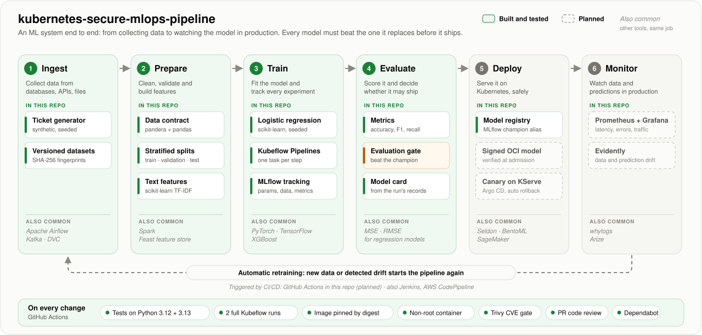
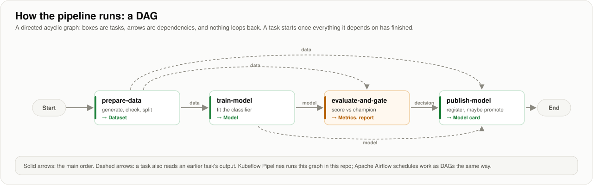

# kubernetes-secure-mlops-pipeline

[](https://github.com/sunilmehta-si/kubernetes-secure-mlops-pipeline/actions/workflows/ci.yml)


[](LICENSE)

An MLOps pipeline on Kubernetes where every model that reaches production is **reproducible, evaluated against the
model it replaces, signed, verified at deploy time, rolled out gradually and rolled back automatically**.

<picture>
  <source media="(prefers-color-scheme: dark)" srcset="docs/images/architecture-dark.svg">
  
</picture>

**Status: under construction.** Every stage above is built and tested, with the governance controls around it:
a risk register, a PII scan, signed models verified before every load, an ML-BOM per model, admission control on a
real cluster, API keys and rate limits, one Helm chart delivered to dev, staging and prod with Argo CD, live drift with Prometheus alerts that start
a retraining run the gate still judges, rollback and retirement. Canary rollouts and keyless signing are next.
This README describes only what works. Each stage also lists other tools commonly used for the same job, so the
diagram doubles as a map of MLOps.

## The gate in action

A model reaches production only by beating the one it replaces. Here a challenger that scores **0.909 accuracy**
clears every absolute floor, but it is measured against the **0.938** champion on the same test tickets, and the gate
blocks it on eight regression checks. A single accuracy number would hide the worst of them, billing recall falling
seven points:

```text
$ smlops train --data data --config challenger.yaml
## Evaluation gate: ticket-router v3 **failed**

| Check                      | Value   | Limit     | Result   |
|----------------------------|---------|-----------|----------|
| drop in accuracy           | +0.0289 | <= 0.0100 | **FAIL** |
| drop in recall[billing]    | +0.0697 | <= 0.0300 | **FAIL** |
| drop in macro_f1[tier=enterprise] | +0.0534 | <= 0.0300 | **FAIL** |
| ...5 more regressions...   |         |           |          |
| accuracy                   | 0.9089  | >= 0.9000 | pass     |
| calibration_error          | 0.0650  | <= 0.1000 | pass     |
smlops: ticket-router v3 registered, not promoted
```

The blocked model is still tracked and registered, so nothing is lost; only the `champion` alias, which production
follows, stays where it was. The full report lists every check, failures first, and is written for CI summaries and
promotion pull requests.

## Quick start

Python 3.12 or newer. Everything runs on a laptop CPU in about a minute.

```bash
git clone https://github.com/sunilmehta-si/kubernetes-secure-mlops-pipeline && cd kubernetes-secure-mlops-pipeline
pip install -e .

smlops data generate -o data            # 3000 tickets, checked against the data contract, fingerprinted splits
smlops train --data data                # validate, train, judge against the champion, register; exit 1 if blocked
smlops pipeline run-local               # the same steps as a Kubeflow pipeline, on KFP's local runner
smlops pipeline compile                 # pipelines/ticket-router-training.yaml, ready to upload to Kubeflow
mlflow ui --backend-store-uri sqlite:///mlflow.db   # browse runs, metrics, gate reports and model cards
```

## Security in practice

Every command below runs in CI on every push (the `drills` job), so this section cannot drift from the code.

```bash
smlops keys generate                                   # P-256 key pair in keys/ (git-ignored, private key 0600)
smlops train --data data --signing-key keys/signing-key.pem   # model files signed as stored; ML-BOM attached
smlops verify --public-key keys/signing-key.pub.pem    # exit 1 if the champion is unsigned or any byte changed
smlops promotion-request -o promotion.md               # PR body with gate result, model card, approver checklist
smlops drift --reference data/train.csv --current batch.csv   # PSI, new words, accuracy; exit 1 on alert
smlops api-keys add --client support-tool --file keys/api-keys.txt   # key printed once; only its hash is stored
smlops rollback                                        # champion back to the previous one, in one step
smlops retire --reason "replaced" --by @owner          # remove every release alias; record why and who
```

- **No pickles:** models are stored with skops, and anything stored as pickle is refused before it is opened.
- **No model without a risk entry:** [`configs/models/`](configs/models/) holds one reviewed entry per model; an
  overdue review blocks training.
- **No personal data in training:** the data contract fails on emails, phone, card and IBAN numbers, and on names
  in introductions, greetings and sign-offs, and reports only masked values.
- **No tampered baseline:** with a verification key, the champion is checked before the gate compares against it.
  A drill flips one byte of the stored champion and the next run stops.

## How the pipeline runs

<picture>
  <source media="(prefers-color-scheme: dark)" srcset="docs/images/pipeline-dag-dark.svg">
  
</picture>

Each task is a thin wrapper around the same function `smlops train` calls, so the command line, the local runner
and a Kubeflow cluster all run the same code. Every run records the fingerprints of its data, the hash of its
parameters, every metric (overall, per team and per slice), the gate decision and a model card.

## Serving, verified twice

The champion is packaged as a signed OCI image and served by KServe on a kind cluster, in CI on every push
([details](docs/serving.md)). Two independent checks stand between a model and traffic: Kyverno admits only images
signed by the pipeline and pinned by digest, and the server verifies the model's own signature before it opens a port.
The latest run:

```text
Argo CD synced release release-39557059626 into serving
ticket-router answered: ["billing","shipping"], model 1
PASS: an unsigned image rejected by verify-model-signatures
PASS: an image referenced by tag rejected by require-registry-and-digest
PASS: a client outside the allowed namespaces could not reach the model
PASS: a request without an API key was refused (401)
PASS: Prometheus scrapes the served model, digest sha256:d539d91cfd41...
PASS: all 11 alert rules loaded
PASS: live drift is measuring the 2 tickets served so far
PASS: the keyless drill request is visible to monitoring as a 401
PASS: a drift alert reached the relay, which would start retraining (dry run, no GitHub token here)
PASS: a hand edit to the endpoint was reverted to the release by Argo CD
PASS: a release adding a ClusterRole and a Secret was refused by the project; neither was created
```

(Twenty checks in all; [docs/serving.md](docs/serving.md) lists every one.) Releases are rendered manifests with
both images by digest (`smlops render-release`). On the CI cluster Argo CD syncs each one from the cluster
registry under the committed project's rules; in production, promoting a model is a pull request that commits
the same files.

## Three environments, one chart

The serving manifests are one Helm chart ([`charts/ticket-router`](charts/ticket-router/)) with a values schema
and secure defaults. Dev, staging and prod differ only in a few lines of values: replicas and resources, never
images or hardening. Each release is the chart rendered for one environment and committed to its own folder;
an ApplicationSet gives every environment its own Argo CD Application and project, and prod only syncs in
working hours.

```bash
smlops render-release --env dev --model-image "$MODEL_IMAGE" --server-image "$SERVER_IMAGE"
smlops promote --from dev --to staging       # the same digests, never a rebuild
smlops promote --from staging --to prod      # dev -> prod directly is refused
```

CI renders and lints the chart in every environment, tests the hardening in each, and fails if a committed release
differs from what the chart renders for it.

## Watching it in production

The server measures its own traffic against the training profile signed into the model: the mix of predicted teams
(PSI) and the share of words its vectorizer has never seen, as a multiple of the model's own baseline. Prometheus
alerts on both with the same thresholds as the batch drift check; eleven alert rules are unit-tested with promtool on
every push, and a Grafana dashboard is generated from code. A critical drift alert goes through Alertmanager to a
token-checked relay that starts the retraining workflow (as does the weekly schedule); the run trains on existing
plus recent tickets, and the challenger still has to beat the champion on recent traffic before a person approves
it. [docs/monitoring.md](docs/monitoring.md) has the details.

## Governance and security

<picture>
  <source media="(prefers-color-scheme: dark)" srcset="docs/images/governance-gates-dark.svg">
  
</picture>

Eight gates decide whether a model may reach production, each leaving evidence and enforced by code where possible.
[docs/governance-and-security.md](docs/governance-and-security.md) has the full design: roles, policies as code, a
threat model with ten threats mapped to the OWASP Machine Learning Top 10, the audit trail from a prediction back to
its data, and the gaps in the order they will be closed. Every item is marked built, partial or planned, and tests
check that nothing is marked built without the file that implements it.

## Caught by its own checks

Problems this project's checks found in itself while it was being built:

- **The default dataset broke its own data contract.** Templated tickets repeated word for word 28% of the time, over
  the 25% limit. The pipeline missed it because it checked each split, the command line checked the whole set. Both
  now share one `prepare` step, and the generator adds neutral per-ticket detail.
- **Leakage inflated accuracy.** 37% of test tickets were exact copies of training tickets, which made the model look
  like 0.958. After the fix only 9% are, the honest score was 0.909, and tuning on the validation split (word trigrams)
  brought it to 0.938 without touching the test set.
- **A failing drill passed the cluster run.** Workflow steps piped drills into `tee` under GitHub's default
  `bash -e`, which ignores a failure on the left of a pipe; a flaky keyless-request drill had failed twice behind
  green runs. The new monitoring check exposed it. Every workflow now runs with `pipefail`, a test enforces it, and
  the drills pass only on curl's own result, never on a kubectl error.
- **A dependency broke every fresh install overnight.** sigstore 4.5.1 stopped pulling in pyOpenSSL, which
  model-signing imports without declaring. Only direct dependencies were pinned; now every transitive package is
  locked, and CI fails if anything outside the lock gets installed.
- **Retraining on recent data alone made a worse model.** Trained only on shifted tickets, a challenger lost 6.6
  points of account recall and the gate blocked it. Retraining now uses existing plus recent tickets, and scored
  0.964 against the champion's 0.942 on the same recent traffic.

## More detail

- [docs/architecture.md](docs/architecture.md): the pipeline step by step, the gate's checks and limits, registry
  aliases for promotion and rollback, what every model carries, and CI.
- [docs/serving.md](docs/serving.md): serving, admission control, the cluster drills and GitOps delivery.
- [docs/monitoring.md](docs/monitoring.md): live drift, alerts, the dashboard, Prometheus on the cluster, retraining.
- [docs/environments.md](docs/environments.md): the Helm chart, dev, staging and prod, the GitOps folder layout and
  promotion one environment at a time.
- The diagrams are generated by [`scripts/architecture_diagram.py`](scripts/architecture_diagram.py); tests fail if
  the committed images drift from the code.

## License

[MIT](LICENSE) © Sunil Mehta
