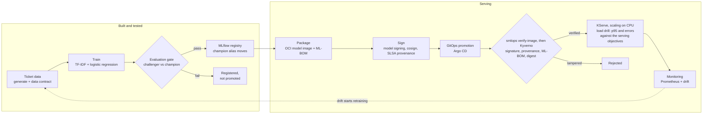
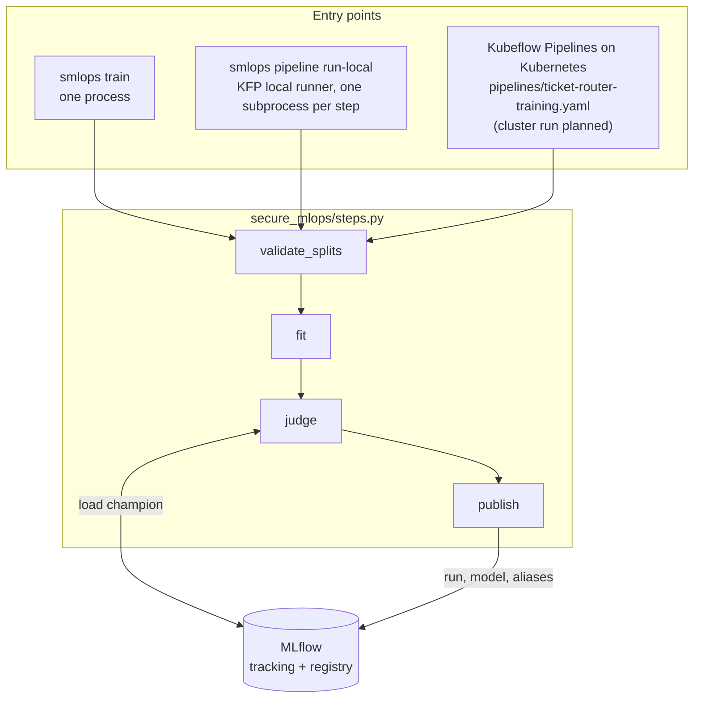
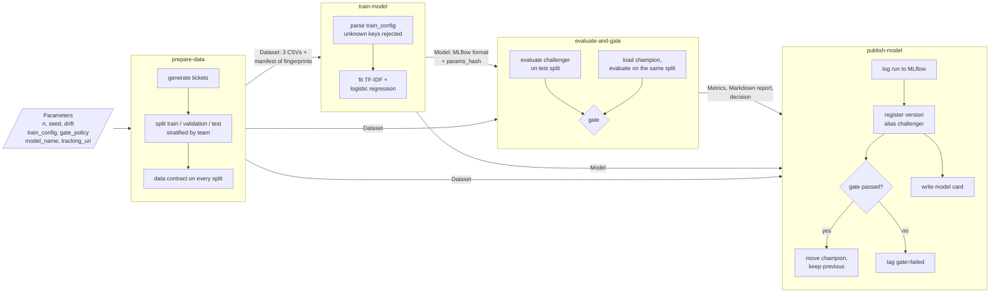
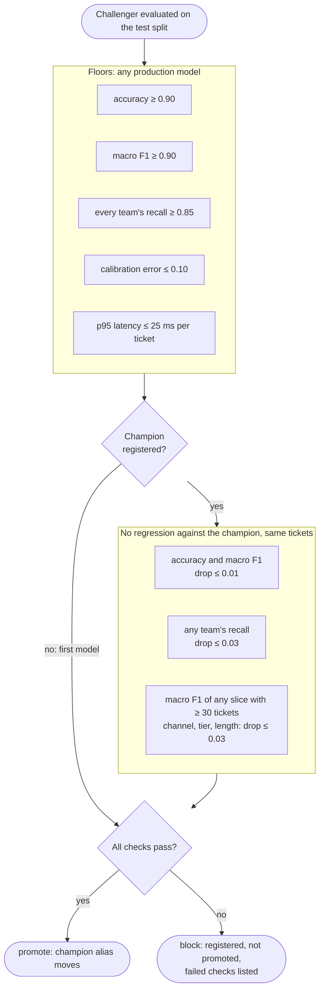
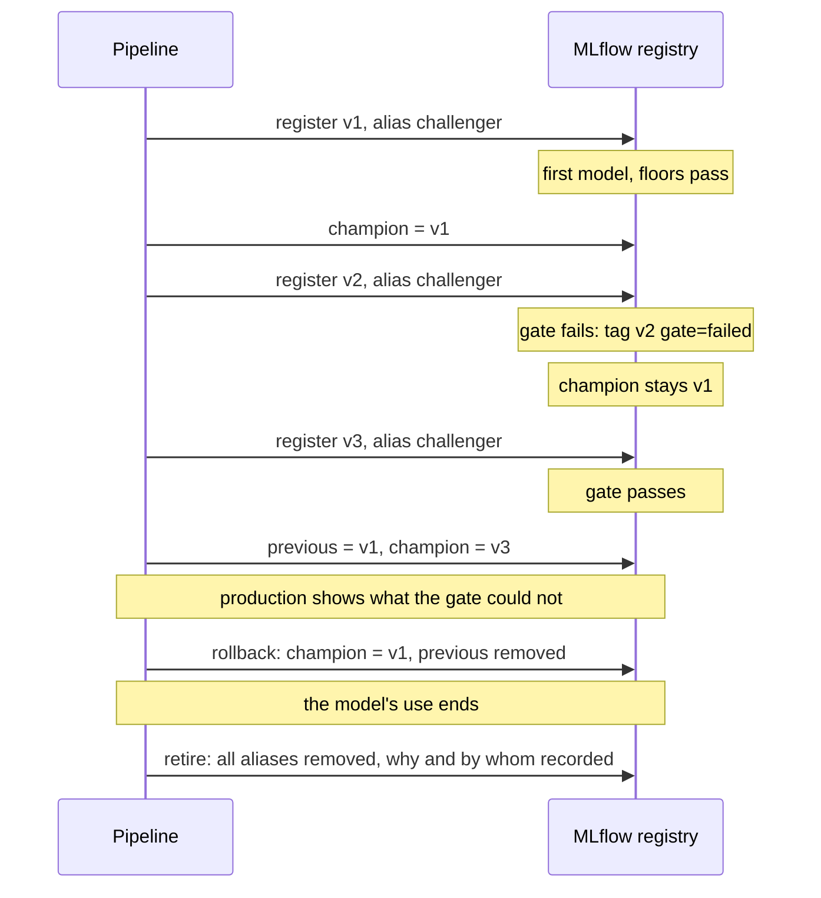
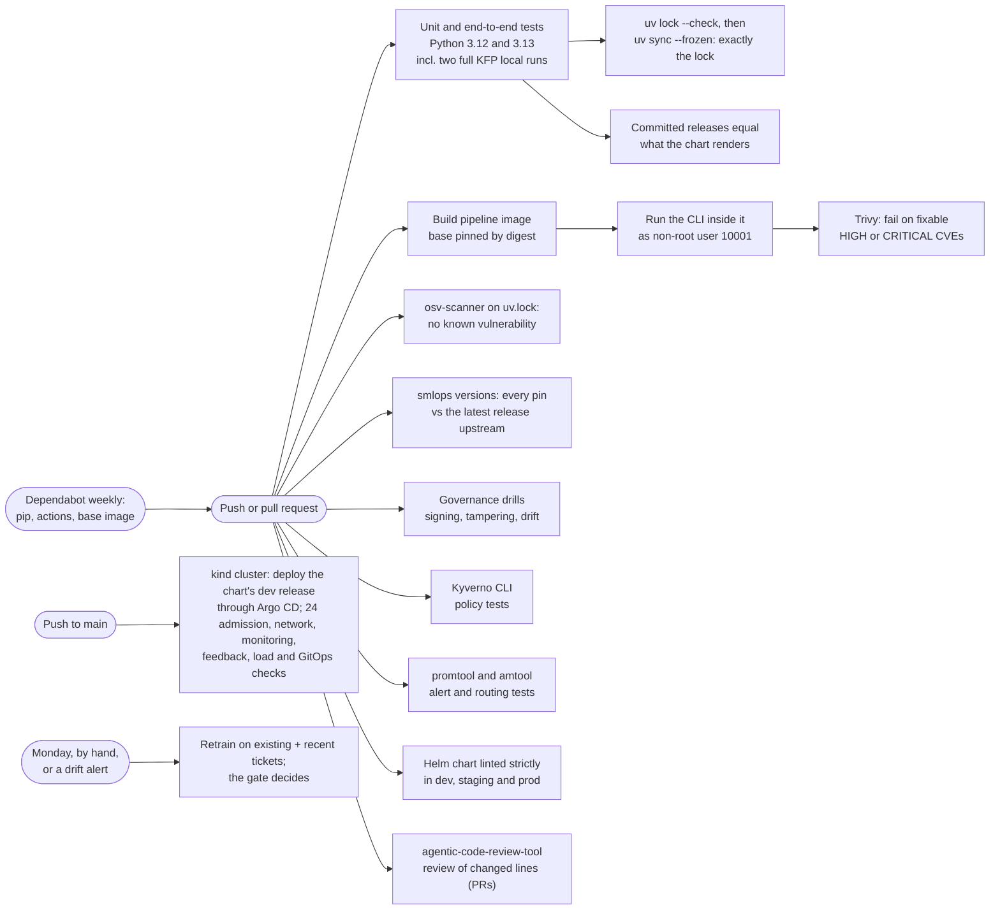

# Architecture

How the pipeline is put together, from the whole model lifecycle down to the checks inside each step.
Stages marked **planned** are designed but not built yet; everything else is in the code and covered by tests.

- [1. The lifecycle](#1-the-lifecycle)
- [2. One code path, three ways to run it](#2-one-code-path-three-ways-to-run-it)
- [3. The training pipeline, step by step](#3-the-training-pipeline-step-by-step)
- [4. The evaluation gate](#4-the-evaluation-gate)
- [5. Registry aliases: promotion and rollback](#5-registry-aliases-promotion-and-rollback)
- [6. What every model carries](#6-what-every-model-carries)
- [7. CI on every change](#7-ci-on-every-change)

## 1. The lifecycle

## 2. One code path, three ways to run it

The same functions in [`steps.py`](../secure_mlops/steps.py) do the work whether a model is trained from the command
line, by the Kubeflow pipeline on a laptop, or by Kubeflow on a cluster. A behaviour tested once is the behaviour
everywhere.

## 3. The training pipeline, step by step

The Kubeflow pipeline ([`pipeline.py`](../secure_mlops/pipeline.py)) has four components. Each passes typed
artifacts to the next, so the Kubeflow UI shows the data, the model, every metric and the gate report of a run.

| Step | Stops the run when | Outputs |
|---|---|---|
| prepare-data | any split breaks the data contract (schema, every team has 20+ tickets, no team above 60%, at most 25% duplicate text) | Dataset: `train.csv`, `validation.csv`, `test.csv`, `manifest.json` with a SHA-256 fingerprint per split |
| train-model | the config has an unknown key or a bad value, or a team is missing from training data | Model in MLflow format, with its `params_hash` |
| evaluate-and-gate | the champion was evaluated on a different test set | Metrics (overall, per team, per slice, latency), Markdown gate report, decision |
| publish-model | never on a gate failure: a blocked model is still recorded and registered, just not promoted | Model card; the registered version number |

## 4. The evaluation gate

Every check is run and reported, failures first, so a blocked model shows everything wrong with it at once.
Limits come from [`configs/gate.yaml`](../configs/gate.yaml).

Slices smaller than 30 tickets are reported but not gated: on so few tickets a drop is noise, and blocking on it
would make the gate flaky.

## 5. Registry aliases: promotion and rollback

The release state lives in three MLflow registry aliases ([`registry.py`](../secure_mlops/registry.py)): what
production should serve is whatever `champion` points at.

`smlops rollback` and `smlops retire` are the commands; a retired model is also marked in its risk entry, after
which nothing trains or promotes it ([docs/monitoring.md](monitoring.md#rollback-and-retirement)).

## 6. What every model carries

From one registered version you can trace back to exactly what produced it:

| Record | Where | What it proves |
|---|---|---|
| Parameter hash | run tag and model version tag `params_hash` | the exact training config |
| Data fingerprints | run tags `data.train`, `data.validation`, `data.test` | the exact tickets, independent of file names or row order |
| Code version | run tag `code_version` | which release of this package trained it |
| Metrics | run metrics, `evaluation.json` | overall, per team, per slice, calibration and latency |
| Gate decision | `gate.json`, `gate.md`, version tag `gate` | every check, its value and its limit |
| Model card | `model_card.md` | intended use, provenance, results and limits, written from the records above |
| Signature | `model.sig.json` on the run (OpenSSF model signing), version tag `signature` | every file is the one that passed the gate; checked before any load |
| ML-BOM | `mlbom.cdx.json` on the run (CycloneDX 1.6) | file hashes, datasets by fingerprint, every installed package |
| Training profile | `smlops_reference` in the signed MLmodel metadata | the team mix, new-word baseline and held-out accuracy that live drift and live accuracy are judged against |
| Release | the signed OCI model image and server image, by digest, in a rendered release | that what runs is what was signed |
| Provenance | a signed SLSA v1 attestation on each image; the ML-BOM attested on the model image | what each image was built from: commit, training run, datasets, dependency lock |

## 7. CI on every change

Every step runs with `pipefail` (a test enforces it), actions are pinned by commit SHA, workflows start with a
read-only token, and no script interpolates event data, so an alert payload cannot run commands.
