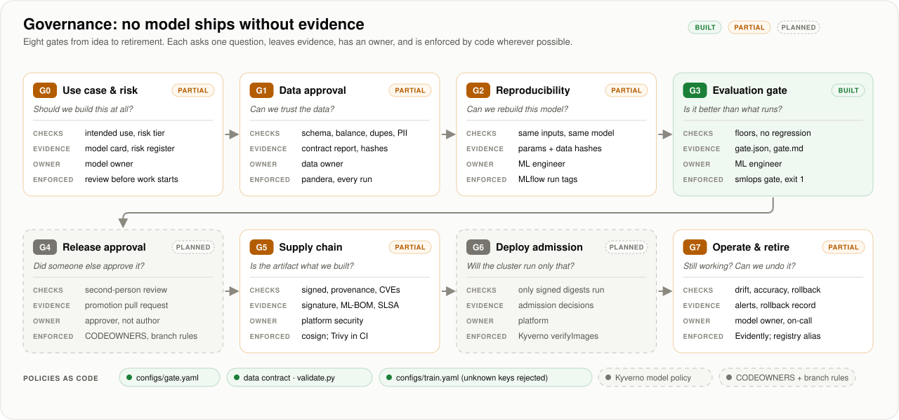
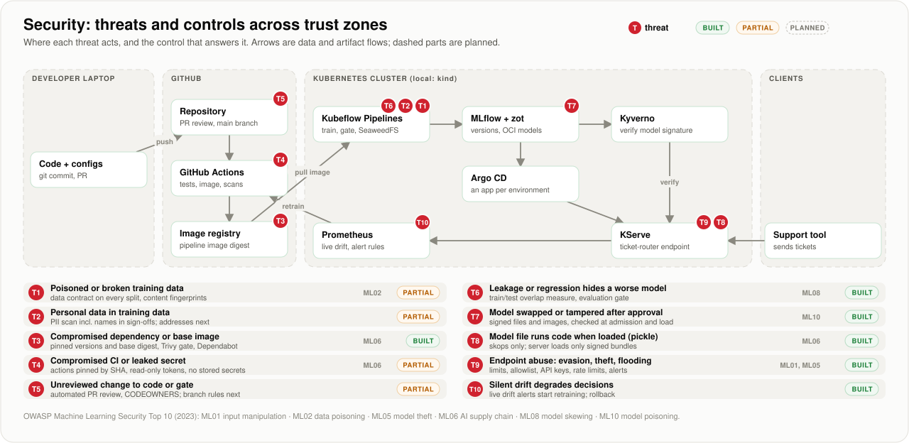
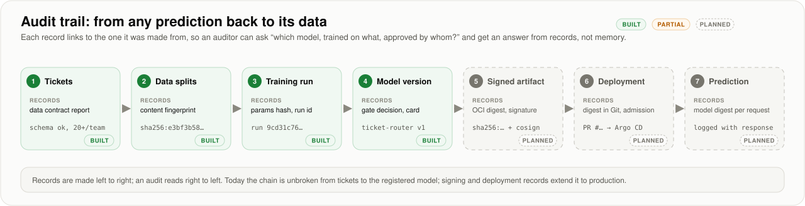

# Governance and security

How this pipeline decides which models may reach production, what evidence each decision leaves, and which threats
it defends against. Every item has a status: **built** (in the code and covered by tests), **partial**, or
**planned**. Built and partial items name the file that implements them, and
[`tests/test_governance.py`](../tests/test_governance.py) checks those files exist, so this page cannot claim more than
the code does.

- [1. Governance gates](#1-governance-gates)
- [2. Roles](#2-roles)
- [3. Policies as code](#3-policies-as-code)
- [4. Threat model](#4-threat-model)
- [5. Audit trail](#5-audit-trail)
- [6. Mapping to frameworks](#6-mapping-to-frameworks)
- [7. Gaps, in the order they will be closed](#7-gaps-in-the-order-they-will-be-closed)

## 1. Governance gates

<picture>
  <source media="(prefers-color-scheme: dark)" srcset="images/governance-gates-dark.svg">
  
</picture>

| Gate | Question | Today | Implemented in | Next |
|---|---|---|---|---|
| G0 Use case & risk | Should we build this at all? | Partial: every model card states the intended use and limits | [`card.py`](../secure_mlops/card.py) | A risk register entry and risk tier per model, reviewed before work starts |
| G1 Data approval | Can we trust the data? | Partial: schema, per-team minimum, balance and duplicate checks on the whole set and on every split; content fingerprints | [`validate.py`](../secure_mlops/validate.py), [`dataset.py`](../secure_mlops/dataset.py) | PII scan before training; source provenance for real data |
| G2 Reproducibility | Can we rebuild this exact model? | Partial: parameter hash, data fingerprints and package version on every run; unknown config keys rejected | [`tracking.py`](../secure_mlops/tracking.py), [`config.py`](../secure_mlops/config.py) | Record the git commit and the pipeline image digest, not only the package version |
| G3 Evaluation gate | Is it better than what runs now? | **Built**: absolute floors, then no regression against the champion overall, per team and per slice; blocks with exit 1 | [`gate.py`](../secure_mlops/gate.py) | Fairness review when real user groups exist |
| G4 Release approval | Did someone other than the author approve it? | Planned | | Promotion by pull request; CODEOWNERS and branch protection so the author cannot approve their own release |
| G5 Supply chain | Is the artifact what we built? | Partial: dependencies and base image pinned, Trivy blocks fixable HIGH/CRITICAL CVEs, Dependabot | [`Dockerfile`](../Dockerfile), [`ci.yml`](../.github/workflows/ci.yml) | Model packaged as an OCI artifact with an ML-BOM, OpenSSF model signature, cosign signature and provenance |
| G6 Deploy admission | Will the cluster run only that artifact? | Planned | | Kyverno `verifyImages` admits only model images signed by the trusted CI identity, pinned by digest |
| G7 Operate & retire | Is it still working, and can we undo it? | Partial: one-step rollback of the `champion` alias | [`registry.py`](../secure_mlops/registry.py) | Drift and accuracy alerts; a retirement step that archives the model and its records |

A model is promoted only when G3 passes today; when G4 to G6 exist, it will be promoted only when all of them pass.

## 2. Roles

One person can hold several roles in a small team; the rule that matters is that **the author of a model never
approves its release alone** (G4).

| Role | Responsible for | Gates |
|---|---|---|
| Model owner | Why the model exists, its intended use, accepting its risks, retiring it | G0, G7 |
| Data owner | Where data comes from, consent and personal data, approving datasets | G1 |
| ML engineer | Training, evaluation, the model card | G2, G3 |
| Approver | Reviewing the promotion pull request: gate report, model card, changes since the last release | G4 |
| Platform / security | Signing identity, registries, admission policy, the CI that builds artifacts | G5, G6 |
| On-call | Responding to drift and accuracy alerts, running rollback | G7 |

## 3. Policies as code

Decisions are made by versioned files, reviewed like code, rather than by settings in a UI:

| Policy | File | Status |
|---|---|---|
| Evaluation gate limits | [`configs/gate.yaml`](../configs/gate.yaml) | Built |
| Data contract | [`secure_mlops/validate.py`](../secure_mlops/validate.py) | Built |
| Training parameters, unknown keys rejected | [`configs/train.yaml`](../configs/train.yaml) | Built |
| CI permissions: read-only token, actions pinned by commit | [`.github/workflows/ci.yml`](../.github/workflows/ci.yml) | Built |
| Who approves releases | `CODEOWNERS` and branch protection | Planned |
| Which model images may run | Kyverno policy in `deploy/` | Planned |

## 4. Threat model

<picture>
  <source media="(prefers-color-scheme: dark)" srcset="images/threat-model-dark.svg">
  
</picture>

| | Threat | Where | Control | OWASP ML Top 10 | Status |
|---|---|---|---|---|---|
| T1 | Poisoned or broken training data | Pipeline | Data contract on the whole set and every split; content fingerprints. Catches broken exports and skew, not a careful poisoner | ML02 | Partial |
| T2 | Personal data in training data | Pipeline | PII scan before training. Today the data is synthetic, so there is none | - | Planned |
| T3 | Compromised dependency or base image | Image registry | Pinned versions, base image by digest, Trivy gate, Dependabot | ML06 | Built |
| T4 | Compromised CI or leaked secret | GitHub Actions | Actions pinned by commit SHA, read-only token, no stored secrets. Keyless signing next | ML06 | Partial |
| T5 | Unreviewed change to code or gate | Repository | Automated review of every pull request. CODEOWNERS and branch protection next | - | Partial |
| T6 | Leakage or regression hides a worse model | Pipeline | Train/test overlap measured on every dataset; evaluation gate against the champion | ML08 | Built |
| T7 | Model swapped or tampered after approval | Registry | Signature over the model, deployment pinned by digest, checked at admission | ML10 | Planned |
| T8 | Model file runs code when loaded (pickle) | Serving | Models are saved with cloudpickle today: loading a tampered file could run code. Switch to skops and load only signed models | ML06 | Planned |
| T9 | Endpoint abuse: evasion, theft, flooding | Serving | Input schema, authentication and rate limits at the gateway, monitoring for unusual query patterns | ML01, ML05 | Planned |
| T10 | Silent drift degrades decisions | Monitoring | Drift and accuracy alerts; one-step rollback (built) | - | Partial |

**What T6 has already caught.** While the README was being written, the overlap measure showed that 37% of test
tickets were exact copies of training tickets, which had inflated accuracy to 0.958. The generator was fixed; the
honest score was 0.909, and tuning on the validation split brought it to 0.938 without touching the test set.

## 5. Audit trail

<picture>
  <source media="(prefers-color-scheme: dark)" srcset="images/audit-trail-dark.svg">
  
</picture>

The questions an auditor or incident review asks, and where the answer comes from today:

| Question | Answer from |
|---|---|
| Which model version is the champion, and which did it replace? | MLflow registry aliases `champion` and `previous` |
| Why was it allowed to ship? | `gate.json` and `gate.md` on its training run: every check, value and limit |
| What data was it trained and tested on? | Run tags `data.train`, `data.validation`, `data.test`: content fingerprints that match the data itself |
| With which parameters and code? | Run tag `params_hash` and the logged parameters; `code_version` (git commit: planned) |
| What is it for, and what are its limits? | `model_card.md` on the run, written from the records above |
| Which model answered a given request? | Planned: the serving digest logged with every prediction |

## 6. Mapping to frameworks

These mappings show where the pipeline's controls sit in widely used frameworks. They are orientation, not a claim
of conformance or certification.

**NIST AI RMF 1.0**

| Function | In this pipeline |
|---|---|
| Govern | Roles, policies as code, release approval (G4, planned), this document |
| Map | Intended use and limits in the model card (G0), threat model (section 4) |
| Measure | Evaluation gate with per-team and per-slice metrics, calibration, leakage measure (G3) |
| Manage | Promotion only on a pass, rollback, drift alerts (G7, partial) |

**OWASP Machine Learning Security Top 10 (2023):** see the threat table; covered entries are ML01, ML02, ML05, ML06,
ML08 and ML10.

**Supply chain (SLSA, OpenSSF model signing):** target is signed provenance for every model artifact, generated by
CI rather than a person's machine, and verified at admission (G5, G6).

**EU AI Act.** A ticket-routing model that sends support requests to a queue for a human to handle is unlikely to be a
high-risk system under the Act's Annex III categories. A provisional agreement in May 2026 moved the Annex III
high-risk obligations to 2 December 2027; check the final published text before relying on dates. This is not legal
advice: classify each real use case with your legal team.

## 7. Gaps, in the order they will be closed

1. **Release approval (G4):** CODEOWNERS, branch protection on `main`, and promotion by pull request.
2. **Safe model format (T8):** save models with skops instead of cloudpickle.
3. **Signing and admission (G5, G6, T7):** OCI model artifact, ML-BOM, signatures from CI's keyless identity, Kyverno
   policy that admits only those.
4. **Reproducibility (G2):** record the git commit and pipeline image digest on every run.
5. **Monitoring (G7, T9, T10):** gateway with authentication and rate limits, drift and accuracy alerts, prediction
   logging with the model digest.
6. **Data (G1, T2):** PII scan, risk register entry per model (G0).

Sources for the framework references: [OWASP Machine Learning Security Top Ten](https://owasp.org/www-project-machine-learning-security-top-10/),
[NIST AI RMF overview and ISO/IEC 42001 comparison (EC-Council)](https://www.eccouncil.org/cybersecurity-exchange/responsible-ai-governance/eu-ai-act-nist-ai-rmf-and-iso-iec-42001-a-plain-english-comparison/),
[EU AI Act omnibus agreement (Gibson Dunn)](https://www.gibsondunn.com/eu-ai-act-omnibus-agreement-postponed-high-risk-deadlines-and-other-key-changes/),
[Sigstore: model signing](https://blog.sigstore.dev/model-transparency-v1.0).
